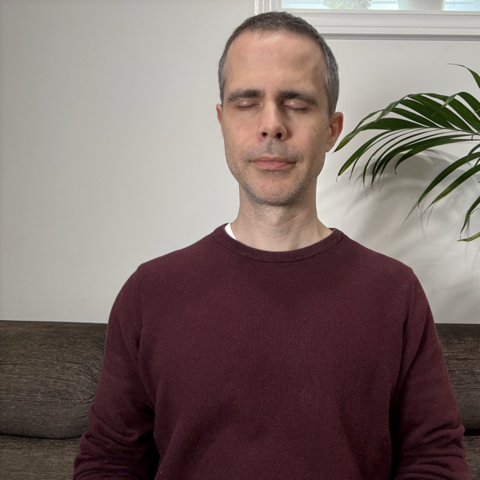

# I meditated for 110 days straight. It changed how I think about helping engineers develop their skills.

Consistency matters more than intensity.

There's a popular productivity concept called "Don't Break the Chain," often associated with Jerry Seinfeld.

The idea is simple.

Do something every day, mark an X on your calendar, and build a chain you don't want to break.

I've applied a version of this to different areas of my life.

I've meditated for over 110 consecutive days, usually for 10 minutes at a time. I've also been working out consistently for years.

And one thing I've learned is that showing up doesn't mean giving the same amount of effort every day.

Life gets in the way.

Some days you're tired. Other days, work or family commitments take priority.

Here are two things that have helped me stay consistent.

**Attach your habit to something you already do.**

Maybe it's after breakfast, after dinner, or after brushing your teeth.

Find something that's already part of your routine and build your new habit around it.

**Use what I call the "step-down ladder."**

Let's say you've committed to 30 minutes of practice.

On a good day, you do all 30.

But when life gets busy, instead of skipping entirely, step down. 
→ Can't do 30 minutes? Try 15. 
→ Can't do 15? Try 10. 
→ Can't do 10? Try 5.

The goal isn't perfection. It's keeping the habit alive.

So what does this have to do with software engineering?

As an engineering manager and coach, I think a lot about how engineers develop their skills.

With how quickly our industry is changing, continuous learning is more important than ever.

But there's a difference between setting a learning goal and creating a habit that makes learning sustainable.

What if, instead of trying to carve out hours, we focused on showing up consistently?

Pick a skill or technology you want to improve.

Attach a small learning session to an existing routine.

Use the step-down ladder when life gets in the way.

Mark off the days as you go, and let consistency do the hard work.

I haven't applied this systematically to technical learning yet.

But having seen what it's done for my meditation and fitness habits, I think it's worth exploring.

Career growth isn't always about making huge leaps forward.

Sometimes it's about taking small steps, consistently, over time.

**When you can't maintain the intensity, reduce the effort. Not the commitment.**

What's one small learning habit you could realistically maintain, even on your busiest days?

	

<a class="coaching-btn" href="https://calendly.com/ziemek-wolski/30min">Book a call with me</a>

