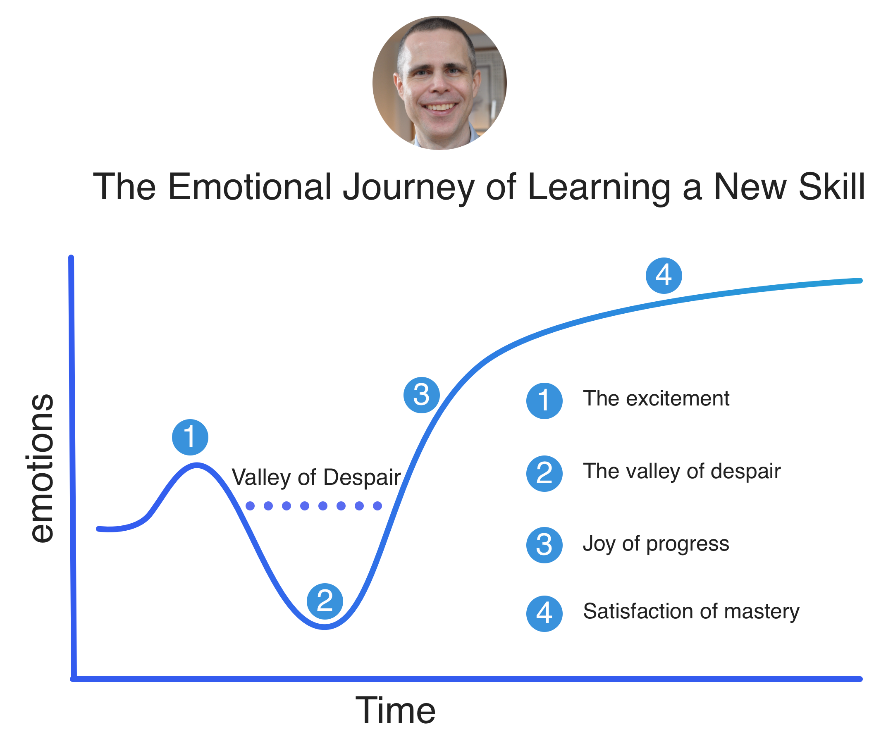

# The Emotional Journey of Learning a New Skill

	

Are you learning a new skill as a software engineer and feeling like you’re not making progress?

Here’s the good news: noticing what you don’t know yet can be a sign that you’re learning.

One framework that helped me understand this is the four stages of learning. Here's how I experienced them while learning mobile development.

The excitement

A feeling of enthusiasm about learning something, along with the belief that it will be easy.

“Mobile development can’t be that hard,” I said to myself.

The valley of despair

The realization that learning the skill is actually much harder than originally thought.

Mobile environments, including both Android and iOS simulators, can be frustrating to work with; often, they seem to fail for no reason at all.

For example, I remember compiling with Xcode and getting this error: “ENOENT: no such file or directory, open /myapp/credentials/firebase-service-credentials.json”. I thought, “What does that even mean?”

An important note about this stage: it’s worthwhile to take credit for every small win. I would say to myself, “I got another error, but I got past the last one! I’m making progress!”

Joy of progress

Ah, things seem to “click”—not all the time, but you are encouraged by your understanding and want to make more progress.

In my example, ensuring that the credentials for authenticating with the Firebase server and all required CocoaPods were configured correctly allowed me to boot my environment.

There were still problems, but I was able to make progress. I could make changes in the development environment and see them reflected instantly. Occasionally, I still saw errors and didn’t understand why things had failed.

Satisfaction of mastery

An ability to complete tasks that were difficult or frustrating in the past.

In my case, navigating CocoaPods and applying a patch to the code helped resolve issues with iOS 27. Resolving issues with the development environment now feels a lot easier because I know what to look for and have a greater understanding of the challenges.

If you’re learning something new and feel stuck, ask yourself: What can I figure out today that would’ve stopped me last week?

That counts as progress, even if it doesn’t feel like things are clicking yet.

Remember, you got this!

<a class="coaching-btn" href="https://calendly.com/ziemek-wolski/30min">Book a call with me</a>
